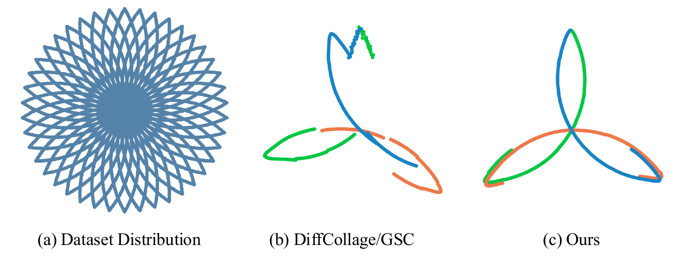
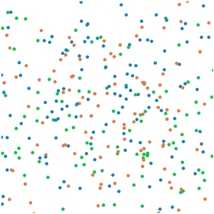
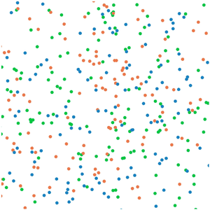
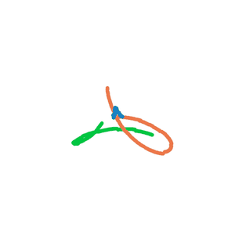
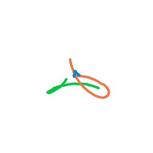

# Compositional Visual Planning via Inference-Time Diffusion Scaling

[[Project page]](https://comp-visual-planning.github.io/)
[[Paper]](https://arxiv.org/abs/2603.02646)
[[ArXiv]](https://arxiv.org/abs/2603.02646)
[[Hugging Face]](https://huggingface.co/comp-visual-planning/toy-example)

[Yixin Zhang](https://yzhang4179.github.io/)<sup>1</sup>,
[Yunhao Luo](https://devinluo27.github.io/)<sup>1, 2</sup>,
[Utkarsh Mishra](https://umishra.me/)<sup>1</sup>,
[Woo Chul Shin](https://woocshin.github.io/profile/)<sup>1</sup>,
[Yongxin Chen](https://yongxin.ae.gatech.edu/)<sup>1</sup>,
[Danfei Xu](https://faculty.cc.gatech.edu/~danfei/)<sup>1</sup>

<sup>1</sup>Georgia Tech,
<sup>2</sup>University of Michigan

This is the official implementation of the toy example of "*Compositional Visual Planning via Inference-Time Diffusion Scaling*" (Figure 2). We train a short-horizon diffusion model on circular arc clips (left). At test time, three 120° arc generators are composed to form a three-petal "flower" (right). The three chunks are denoised together, and our method keeps them consistent by enforcing agreement of their Tweedie estimates at the chunk boundaries at every denoising step.

<p align="center">
  
</p>

## 🛠️ Getting Started

```bash
conda create -n cvp_toy python=3.10
conda activate cvp_toy
pip install torch==2.2.1 --index-url https://download.pytorch.org/whl/cu121
pip install -e .
```

All hyper-parameters are in [`configs/toy.yaml`](configs/toy.yaml), and any of them can be overridden on the command line with [Hydra](https://hydra.cc/) syntax, e.g. `python eval.py method=gsc seed=1`. Paths in the config are relative to the repository root, so run the scripts from there.

## 📊 Using Pretrained Models and Data

The checkpoint used in the paper and the training data are on the Hugging Face Hub at [comp-visual-planning/toy-example](https://huggingface.co/comp-visual-planning/toy-example). `train.py` and `eval.py` download them into `ckpts/` and `data/` when the files are missing, so you can run inference right away. To download them by hand:

```bash
hf download comp-visual-planning/toy-example diffusion_420000.ckpt --local-dir ckpts
hf download comp-visual-planning/toy-example toy.npy --local-dir data
```

| File | Description | Size |
| --- | --- | --- |
| [`diffusion_420000.ckpt`](https://huggingface.co/comp-visual-planning/toy-example/blob/main/diffusion_420000.ckpt) | DiT1d denoiser (online and EMA weights) after 420k gradient steps, used in Figure 2 | 132 MB |
| [`toy.npy`](https://huggingface.co/comp-visual-planning/toy-example/blob/main/toy.npy) | training data, array of shape (64, 600, 2): 64 rotated flowers of 600 (x, y) points | 0.6 MB |

You can also generate the data and train the model yourself:

```bash
python datagen.py   # writes data/toy.npy and a preview data/dataset.png
python train.py     # see below
```

<p align="center">
  
  <br>
  <em>Training data: rotated copies of the flower, each a closed curve of three noisy 120° arcs.</em>
</p>

## 🚀 Training

```bash
python train.py
```

This trains a 6-block DiT1d (width 384, 12 heads) as an x0-predicting DDPM with 500 cosine diffusion steps. Each training clip has 240 consecutive points, split into 8 tokens of 30 points. The defaults are batch size 128, learning rate 1e-4 and 1M gradient steps. A checkpoint is saved to `ckpts/diffusion_<step>.ckpt` every 30k steps, and the released checkpoint is the one after 420k steps. To change the run, override e.g. `gradient_steps`, `batch_size`, `lr`, `num_workers` or `ckpt_dir`.

## 🏃‍♂️ Inference

```bash
python eval.py method=cvp
```

This composes three 8-token chunks into a 600-point flower (`canon_horizon=20`, `stride=6`, so neighboring chunks share two tokens). The start and goal are the first and last token of a training episode. The outputs go to `outputs/cvp/`:

- `xts.mp4`: the noisy chunks over the 300 denoising steps, one frame every 9 steps
- `x0s.mp4`: their Tweedie estimates (the predicted clean samples) over the same steps
- `plan.png`: the final plan, one color per chunk

Three parameters control the guidance: `wg` is the share of the guidance direction in the noise of the stochastic DDIM step, `discount` decays the boundary losses with the distance from the start and goal, and `w_sync` weights the sync loss. See `CVP.cvp_sample` in [`cvp/diffusion/cvp.py`](cvp/diffusion/cvp.py) for details.

|  | GSC (DiffCollage) | Ours |
| :---: | :---: | :---: |
| Noisy samples |  |  |
| Estimated Tweedies |  |  |

## 📔 Baselines

```bash
python eval.py method=gsc
```

This runs the baseline (`CVP.gsc_sample`) with the same checkpoint and chunks, and writes to `outputs/gsc/`. Following [DiffCollage](https://arxiv.org/abs/2303.17076), it averages the overlapping tokens of neighboring chunks after every deterministic DDIM step and writes the start and goal tokens back. [Generative Skill Chaining (GSC)](https://arxiv.org/abs/2401.03360) extends the same formulation to robot task-and-motion planning as DiffCollage follow-up work, which is where the sampler gets its name. In the videos above, the averaged chunks drift and leave gaps between the factors, while our sampler converges to a single consistent flower.

## 🙏 Acknowledgement
* The implementation of DDPM and DiT is adapted from [CleanDiffuser](https://github.com/CleanDiffuserTeam/CleanDiffuser).

Contact [Yixin Zhang](mailto:yzhang4179@gatech.edu) if you have any questions or suggestions.

## 📝 Citations
If you find our work useful, please consider citing:
```bibtex
@misc{zhang2026compositionalvisualplanninginferencetime,
      title={Compositional Visual Planning via Inference-Time Diffusion Scaling},
      author={Yixin Zhang and Yunhao Luo and Utkarsh Aashu Mishra and Woo Chul Shin and Yongxin Chen and Danfei Xu},
      year={2026},
      eprint={2603.02646},
      archivePrefix={arXiv},
      primaryClass={cs.RO},
      url={https://arxiv.org/abs/2603.02646},
}
```
